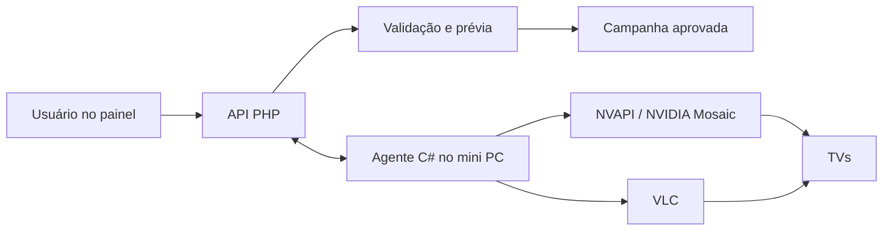
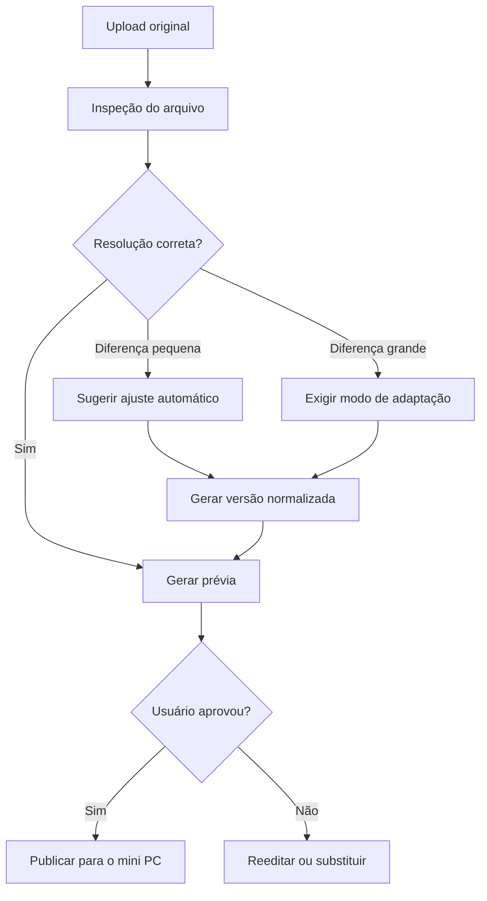
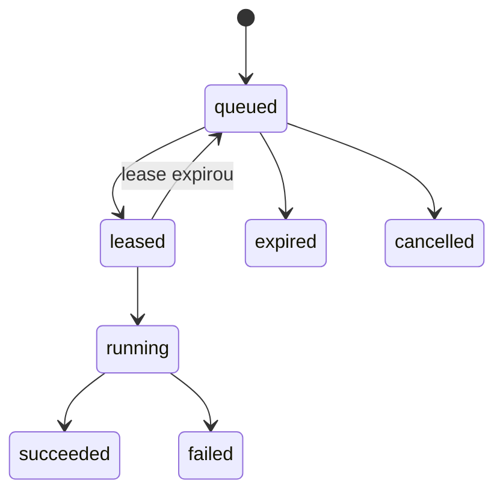
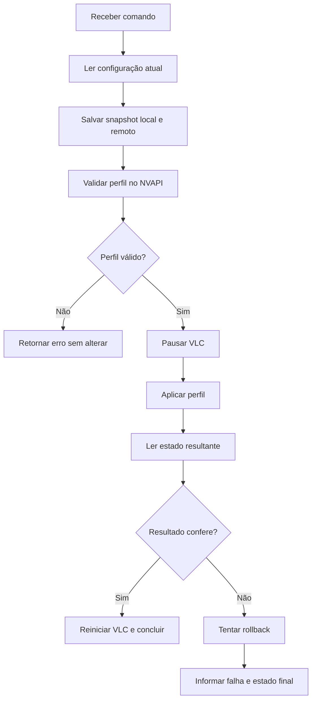

# Arquitetura do sistema de campanhas para TVs

## API PHP, agente C#, VLC e NVIDIA Mosaic

**Status:** proposta técnica para implementação  
**Objetivo:** transformar o VLC em um reprodutor simples e previsível, deixando a validação das campanhas, a geração das prévias e o controle remoto sob responsabilidade da API PHP e de um agente C# instalado em cada mini PC.

---

## 1. Visão geral

O sistema será dividido em dois componentes principais:

1. **API e painel em PHP**: recebem as campanhas, validam os arquivos, normalizam as imagens, exibem a prévia, controlam publicação, armazenam os perfis de tela e criam comandos remotos.
2. **Agente local em C#**: roda no mini PC, consulta os comandos pendentes, coleta informações do Windows e do NVIDIA Mosaic, controla o VLC e devolve o resultado de cada operação.

O VLC não decidirá resolução, proporção, recorte ou organização das telas. Ele receberá somente arquivos já aprovados e adaptados para a resolução final do videowall.



---

## 2. Decisões principais

- A campanha original nunca será sobrescrita.
- A API gerará uma versão normalizada para cada destino.
- A prévia será obrigatória antes da publicação.
- O tamanho esperado será calculado a partir do perfil do videowall.
- Quando o agente estiver disponível, a resolução real informada pelo Mosaic terá prioridade sobre um valor cadastrado manualmente.
- O VLC apenas exibirá o arquivo final.
- O agente C# aceitará somente comandos previamente definidos; não haverá execução livre de PowerShell, CMD ou código enviado pelo servidor.
- Alterações no Mosaic terão validação prévia, captura da configuração atual, verificação posterior e tentativa de rollback.
- Todos os comandos e resultados serão auditáveis.

---

## 3. Padrões de resolução

Cada TV utiliza como base:

- **Horizontal:** 1920 × 1080.
- **Vertical:** 1080 × 1920.

O tamanho final depende da disposição física.

| Disposição | Resolução final esperada |
|---|---:|
| 1 TV horizontal | 1920 × 1080 |
| 1 TV vertical | 1080 × 1920 |
| 2 TVs horizontais lado a lado | 3840 × 1080 |
| 3 TVs horizontais lado a lado | 5760 × 1080 |
| 4 TVs horizontais lado a lado | 7680 × 1080 |
| 4 TVs horizontais em 2 × 2 | 3840 × 2160 |
| 4 TVs verticais lado a lado | 4320 × 1920 |

Fórmula geral, sem compensação de bordas:

```text
largura total = largura de cada tela × quantidade de colunas
altura total  = altura de cada tela × quantidade de linhas
```

Se o Mosaic utilizar compensação de bordas ou sobreposição, a resolução efetiva poderá ser diferente. Nesse caso, o valor detectado pelo agente será utilizado para validar a campanha.

---

# Parte I — API e painel PHP

## 4. Responsabilidades da API PHP

A API será a fonte de verdade do sistema. Suas responsabilidades serão:

- cadastrar lojas, mini PCs e videowalls;
- armazenar perfis de resolução e disposição;
- receber os arquivos originais;
- identificar formato, largura, altura e integridade;
- validar a resolução da campanha;
- sugerir ou executar a correção;
- gerar prévia com divisão entre as TVs;
- armazenar original e arquivo normalizado;
- exigir aprovação antes da publicação;
- disponibilizar o arquivo final para o agente;
- criar, entregar e acompanhar comandos remotos;
- receber telemetria do agente;
- registrar auditoria e histórico de falhas.

## 5. Fluxo da campanha



### 5.1 Inspeção

No upload, a API deverá verificar:

- MIME type real, não apenas a extensão;
- formato permitido;
- largura e altura;
- se o arquivo pode ser decodificado;
- tamanho máximo em bytes;
- hash SHA-256;
- perfil do videowall selecionado;
- proporção da origem e do destino.

Para o MVP, recomenda-se aceitar PNG, JPEG e WebP e gerar uma saída padronizada em PNG ou JPEG. O PHP pode utilizar a extensão GD para leitura e reamostragem. O suporte a outros formatos poderá ser adicionado posteriormente.

### 5.2 Classificação do resultado

| Situação | Resultado |
|---|---|
| Dimensão exata | Aprovada para prévia |
| Diferença de até 2 px por dimensão | Ajuste simples sugerido |
| Mesma proporção, mas dimensão diferente | Redimensionamento sugerido |
| Proporção diferente | Usuário escolhe encaixar, preencher ou esticar |
| Arquivo ilegível | Upload bloqueado |
| Resolução desconhecida | Publicação bloqueada até definir o destino |

A tolerância de 2 px deve ser configurável.

### 5.3 Modos de correção

| Modo | Uso recomendado | Efeito |
|---|---|---|
| `EDGE_ADJUST` | Diferença de 1 ou 2 px | Adiciona ou remove pixels nas bordas |
| `FIT` | Preservar todo o conteúdo | Encaixa e adiciona bordas quando necessário |
| `FILL` | Preencher toda a tela | Preserva proporção, mas pode cortar conteúdo |
| `STRETCH` | Quando deformação for aceita | Força exatamente a largura e altura do destino |
| `REJECT` | Conteúdo crítico | Solicita um novo arquivo |

Para campanhas com preços e textos próximos das bordas, `FILL` não deve ser aplicado automaticamente. O padrão para diferenças mínimas será `EDGE_ADJUST`.

### 5.4 Arquivos armazenados

Para cada mídia, devem existir:

- `original`: arquivo recebido sem alterações;
- `normalized`: versão adaptada ao destino;
- `preview`: versão leve usada no painel;
- metadados: dimensões, formato, hash, modo de ajuste e data do processamento.

Um mesmo original poderá gerar versões normalizadas diferentes para destinos diferentes.

## 6. Prévia obrigatória

A prévia deverá reproduzir o videowall, e não mostrar somente a imagem reduzida.

Recursos necessários:

- proporção fiel ao tamanho final;
- divisórias entre as TVs;
- identificação `TV 1`, `TV 2`, `TV 3` e assim por diante;
- simulação opcional da espessura das bordas;
- área segura para preços, textos e logotipos;
- zoom;
- modo tela cheia;
- comparação entre original e corrigida;
- indicação da dimensão recebida e esperada;
- indicação do tipo de ajuste aplicado;
- confirmação explícita antes de publicar.

Exemplo para quatro TVs horizontais:

```text
Canvas: 7680 × 1080
Divisões verticais: 1920, 3840 e 5760 px
```

Se houver compensação de bordas configurada no Mosaic, a prévia poderá utilizar os valores retornados pelo agente para simular as áreas escondidas.

## 7. Cadastros e entidades sugeridas

### 7.1 `devices`

Representa o mini PC.

- `id`
- `store_id`
- `name`
- `device_uuid`
- `status`
- `last_seen_at`
- `agent_version`
- `windows_version`
- `gpu_name`
- `driver_version`
- `current_display_profile_id`

### 7.2 `display_profiles`

Representa um perfil aprovado de tela ou Mosaic.

- `id`
- `name`
- `rows`
- `columns`
- `display_width`
- `display_height`
- `orientation`
- `total_width`
- `total_height`
- `refresh_rate`
- `overlap_x`
- `overlap_y`
- `nvapi_payload`
- `is_tested`
- `tested_at`

### 7.3 `media_assets`

- `id`
- `original_path`
- `original_width`
- `original_height`
- `mime_type`
- `sha256`
- `processing_status`
- `created_by`

### 7.4 `media_variants`

- `id`
- `media_asset_id`
- `display_profile_id`
- `variant_type`
- `path`
- `width`
- `height`
- `adjustment_mode`
- `processing_details`
- `sha256`
- `approved_at`
- `approved_by`

### 7.5 `device_commands`

- `id` ou UUID
- `device_id`
- `type`
- `payload`
- `status`
- `priority`
- `idempotency_key`
- `lease_expires_at`
- `requested_by`
- `created_at`
- `started_at`
- `finished_at`
- `expires_at`
- `result`
- `error_code`
- `error_message`

### 7.6 `device_heartbeats`

- `device_id`
- `received_at`
- `vlc_status`
- `mosaic_status`
- `desktop_width`
- `desktop_height`
- `screens_detected`
- `cpu_usage`
- `memory_usage`
- `free_disk_space`
- `last_command_id`

### 7.7 `audit_logs`

Registra quem criou, aprovou ou executou cada operação importante.

## 8. Estados de um comando



- `queued`: aguardando o agente.
- `leased`: reservado temporariamente por um agente.
- `running`: execução confirmada.
- `succeeded`: finalizado com sucesso.
- `failed`: finalizado com erro.
- `expired`: perdeu a validade antes da execução.
- `cancelled`: cancelado antes da execução.

O lease impede que o mesmo comando seja executado simultaneamente duas vezes. A `idempotency_key` impede duplicidade em novas tentativas.

## 9. Endpoints sugeridos

### Administração e campanhas

```http
POST   /api/media
POST   /api/media/{media}/normalize
GET    /api/media/{media}/preview
POST   /api/media/{media}/approve
POST   /api/campaigns/{campaign}/publish

GET    /api/devices
GET    /api/devices/{device}
GET    /api/devices/{device}/display-state
POST   /api/devices/{device}/commands
GET    /api/devices/{device}/commands
```

### Comunicação do agente

```http
POST   /api/agent/register
POST   /api/agent/heartbeat
POST   /api/agent/display-state
GET    /api/agent/commands/next
POST   /api/agent/commands/{command}/started
POST   /api/agent/commands/{command}/completed
POST   /api/agent/commands/{command}/failed
```

O agente poderá consultar comandos por polling curto, por exemplo a cada 5 segundos. No futuro, poderá ser adotado WebSocket ou SignalR, sem mudar o modelo de comandos.

## 10. Exemplo de comando

```json
{
  "id": "c80dd102-78fc-46fb-b993-637c52ef14a9",
  "type": "mosaic.apply_profile",
  "device_id": "tv-player-loja-04",
  "idempotency_key": "loja-04-mosaic-profile-3-v1",
  "expires_at": "2026-10-15T03:00:00Z",
  "payload": {
    "profile_id": 3,
    "rows": 1,
    "columns": 4,
    "display_width": 1920,
    "display_height": 1080,
    "total_width": 7680,
    "total_height": 1080,
    "refresh_rate": 60,
    "overlap_x": 0,
    "overlap_y": 0
  }
}
```

## 11. Comandos permitidos

### VLC

- `vlc.status`
- `vlc.start`
- `vlc.stop`
- `vlc.restart`
- `vlc.reload_playlist`
- `campaign.download`
- `campaign.activate`

### Mosaic e telas

- `mosaic.inspect`
- `mosaic.validate_profile`
- `mosaic.apply_profile`
- `mosaic.restore_snapshot`
- `mosaic.enable_current`
- `mosaic.disable_current`

### Mini PC

- `device.collect_diagnostics`
- `device.restart_agent`
- `device.restart_computer`

Comandos críticos, como alteração do Mosaic ou reinicialização, devem exigir permissão específica no painel e confirmação adicional.

## 12. Publicação de campanha

Ao publicar:

1. A API confirma que existe uma variante aprovada para o perfil atual.
2. A API compara a dimensão da variante com a dimensão real mais recente do dispositivo.
3. A API cria `campaign.download`.
4. O agente baixa o arquivo para uma área temporária.
5. O agente valida tamanho e SHA-256.
6. O agente move o arquivo para a área ativa.
7. O agente executa `campaign.activate` ou recarrega a playlist.
8. O agente confirma o conteúdo ativo.
9. A API registra a versão efetivamente exibida.

Se o download falhar, o agente mantém a campanha anterior. Nunca deve existir um intervalo em que o arquivo antigo foi removido e o novo ainda não foi validado.

---

# Parte II — Agente local em C#

## 13. Responsabilidades do agente

O agente C# será o executor local e terá responsabilidades limitadas:

- registrar o mini PC na API;
- enviar heartbeat;
- consultar comandos pendentes;
- garantir execução idempotente;
- baixar e validar campanhas;
- controlar o processo do VLC;
- consultar Windows, GPU, driver e telas;
- consultar e configurar o NVIDIA Mosaic pelo NVAPI;
- capturar snapshot antes de mudanças;
- confirmar o estado após cada mudança;
- tentar rollback quando necessário;
- devolver resultados e diagnósticos.

O agente não fará tratamento visual das imagens. Ele apenas valida hash e dimensões antes de ativar o arquivo recebido.

## 14. Estrutura sugerida da solução .NET

```text
TvAgent.sln
├── TvAgent.Service
│   ├── Worker
│   ├── ApiClient
│   ├── Heartbeat
│   ├── CommandPolling
│   └── UpdateManager
├── TvAgent.SessionHost
│   ├── VlcManager
│   ├── DisplayManager
│   └── ScreenshotManager
├── TvAgent.NvApi
│   ├── NativeInterop
│   ├── MosaicReader
│   ├── MosaicValidator
│   ├── MosaicWriter
│   └── MosaicSnapshot
├── TvAgent.Commands
│   ├── CommandDispatcher
│   ├── Handlers
│   └── Results
├── TvAgent.Domain
│   ├── Devices
│   ├── Displays
│   └── Commands
└── TvAgent.Tests
```

### 14.1 `TvAgent.Service`

Windows Service responsável por:

- iniciar junto com o Windows;
- autenticar na API;
- enviar heartbeat;
- buscar comandos;
- gerenciar leases e tentativas;
- manter a comunicação mesmo se o VLC estiver fechado;
- atualizar o agente de forma controlada.

### 14.2 `TvAgent.SessionHost`

Aplicativo executado na sessão do usuário responsável pelas ações que dependem do desktop interativo:

- controlar a janela e o processo do VLC;
- realizar operações de display quando necessário;
- coletar capturas de tela autorizadas;
- comunicar-se localmente com o Windows Service.

A separação entre Service e SessionHost deve ser validada no protótipo, pois operações gráficas podem se comportar de maneira diferente na Session 0 do Windows.

### 14.3 `TvAgent.NvApi`

Camada isolada para integração nativa. Nenhum outro módulo deve chamar diretamente as funções do NVAPI.

Funções principais:

- inicializar e encerrar NVAPI;
- enumerar grades ativas;
- obter a topologia atual;
- obter resolução e overlap;
- validar uma grade proposta;
- aplicar uma grade;
- habilitar ou desabilitar topologia atual;
- converter códigos NVAPI em erros legíveis.

Para Windows 10 e superior, devem ser priorizadas as APIs atuais:

- `NvAPI_Mosaic_EnumDisplayGrids`;
- `NvAPI_Mosaic_GetCurrentTopo`;
- `NvAPI_Mosaic_ValidateDisplayGrids`;
- `NvAPI_Mosaic_SetDisplayGrids`;
- `NvAPI_Mosaic_EnableCurrentTopo`.

Funções antigas marcadas pela NVIDIA como não suportadas no Windows 10 ou superior não devem ser utilizadas.

## 15. Processamento de comandos no agente

O `CommandDispatcher` associa cada tipo de comando a um handler conhecido.

```csharp
public interface ICommandHandler<TPayload>
{
    Task<CommandResult> ExecuteAsync(
        TPayload payload,
        CancellationToken cancellationToken);
}
```

Fluxo de execução:

1. Buscar o próximo comando.
2. Conferir validade, tipo e idempotência.
3. Confirmar `started` para a API.
4. Executar o handler permitido.
5. Verificar o resultado real.
6. Enviar `completed` ou `failed`.
7. Salvar localmente o último resultado para recuperação após reinício.

Um comando já concluído não poderá ser executado novamente, mesmo que a API repita a entrega por falha de rede.

## 16. Integração com o VLC

O `VlcManager` deverá:

- localizar o executável configurado;
- iniciar com argumentos padronizados;
- impedir múltiplas instâncias indevidas;
- verificar se o processo está respondendo;
- reiniciar quando comandado;
- recarregar a campanha;
- registrar saída e erros;
- informar qual arquivo ou playlist está ativo.

Configurações como modo tela cheia, repetição, ocultação de controles e posicionamento devem ficar em um perfil local controlado pelo agente.

O VLC nunca receberá um arquivo ainda incompleto. O download será realizado com um nome temporário e somente após a validação será promovido para a pasta ativa.

## 17. Leitura do Mosaic

O agente deverá produzir um estado normalizado, independentemente da estrutura nativa do NVAPI:

```json
{
  "enabled": true,
  "rows": 1,
  "columns": 4,
  "display_width": 1920,
  "display_height": 1080,
  "total_width": 7680,
  "total_height": 1080,
  "refresh_rate": 60,
  "overlap_x": 0,
  "overlap_y": 0,
  "displays": [
    { "position": 1, "display_id": "...", "rotation": 0 },
    { "position": 2, "display_id": "...", "rotation": 0 },
    { "position": 3, "display_id": "...", "rotation": 0 },
    { "position": 4, "display_id": "...", "rotation": 0 }
  ]
}
```

Essa resposta será enviada à API para comparação com o perfil esperado.

## 18. Aplicação segura de perfil Mosaic



Regras obrigatórias:

- não aplicar um perfil que falhou na validação;
- salvar snapshot antes de qualquer alteração;
- registrar todas as saídas envolvidas;
- definir timeout para o retorno do driver;
- verificar a resolução real depois da mudança;
- tentar restaurar o snapshot se a resolução não corresponder;
- permitir alterações apenas em perfis aprovados no MVP;
- sinalizar necessidade de atendimento local se o rollback falhar.

## 19. Configuração local do agente

Exemplo de `appsettings.json`:

```json
{
  "Agent": {
    "DeviceId": "tv-player-loja-04",
    "ApiBaseUrl": "https://painel.exemplo.com/api/agent",
    "HeartbeatSeconds": 30,
    "CommandPollingSeconds": 5,
    "WorkingDirectory": "C:\\ProgramData\\TvAgent",
    "VlcPath": "C:\\Program Files\\VideoLAN\\VLC\\vlc.exe"
  }
}
```

O segredo do dispositivo não deve ficar em texto puro no arquivo. Deve ser protegido utilizando mecanismo seguro do Windows, como DPAPI ou armazenamento equivalente.

## 20. Diagnósticos enviados pelo agente

- horário local e UTC;
- versão do agente;
- versão do Windows;
- tempo ligado;
- GPU e driver;
- telas detectadas;
- estado atual do Mosaic;
- resolução do desktop;
- status e PID do VLC;
- campanha ativa;
- uso de CPU e memória;
- espaço livre em disco;
- último comando executado;
- últimos erros relevantes.

Capturas de tela devem ser opcionais, auditadas e solicitadas explicitamente.

---

# Parte III — Comunicação, segurança e operação

## 21. Autenticação do dispositivo

Cada mini PC terá:

- um UUID exclusivo;
- uma credencial individual;
- possibilidade de revogação;
- rotação de credencial;
- vínculo com uma loja;
- registro da primeira ativação.

Todas as comunicações utilizarão HTTPS. A API deverá recusar um dispositivo revogado, um comando expirado ou uma resposta referente a outro dispositivo.

## 22. Segurança dos comandos

- Lista fechada de tipos de comando.
- Payload validado por schema.
- Perfis Mosaic aprovados previamente.
- Controle de acesso por função no painel.
- Confirmação para operações críticas.
- Idempotência e expiração.
- Download com hash SHA-256.
- Auditoria de usuário, dispositivo, horário e resultado.
- Sem execução de comandos arbitrários do sistema operacional.
- Limite de tentativas e bloqueio temporário após erros repetidos.

## 23. Funcionamento offline

Se a API ficar indisponível:

- o VLC continua exibindo a última campanha válida;
- o agente mantém o último perfil aprovado;
- comandos não confirmados não são presumidos como concluídos;
- heartbeats são retomados quando a conexão voltar;
- a campanha atual não é removida;
- eventos locais podem ser armazenados temporariamente para envio posterior.

## 24. Falhas previstas

| Falha | Comportamento esperado |
|---|---|
| Arquivo inválido | API bloqueia antes da publicação |
| Dimensão incorreta | Prévia e correção obrigatórias |
| Download interrompido | Manter campanha anterior |
| Hash diferente | Rejeitar arquivo e tentar novamente |
| VLC travado | Reiniciar e registrar diagnóstico |
| Tela desconectada | Alertar painel e impedir perfil incompatível |
| Perfil Mosaic inválido | Não aplicar |
| Aplicação Mosaic divergente | Tentar rollback |
| Rollback falhou | Marcar equipamento para atendimento local |
| Agente offline | Manter última campanha e alertar painel |

## 25. Logs e auditoria

### Na API

- upload e processamento;
- aprovação da prévia;
- publicação da campanha;
- criação e cancelamento de comandos;
- alteração de perfil;
- usuário responsável;
- resultado retornado pelo agente.

### No agente

- início e parada do serviço;
- comunicação com API;
- comandos recebidos;
- resultado de cada handler;
- mensagens do NVAPI;
- inicialização e encerramento do VLC;
- downloads e validação de hash;
- snapshots e rollbacks.

Os logs não devem armazenar tokens, segredos ou URLs temporárias completas.

---

# Parte IV — Testes sem TVs e preparação para NVIDIA

## 26. Estratégia com provedores intercambiáveis

O agente deve ser desenvolvido sem dependência direta do NVAPI nos handlers de comandos. Todas as operações de tela passarão por uma abstração única:

```csharp
public interface IDisplayController
{
    Task<DisplayState> GetCurrentStateAsync(
        CancellationToken cancellationToken);

    Task<DisplayValidationResult> ValidateProfileAsync(
        DisplayProfile profile,
        CancellationToken cancellationToken);

    Task<DisplayApplyResult> ApplyProfileAsync(
        DisplayProfile profile,
        CancellationToken cancellationToken);

    Task<DisplayApplyResult> RestoreSnapshotAsync(
        DisplaySnapshot snapshot,
        CancellationToken cancellationToken);
}
```

Serão criadas duas implementações:

| Implementação | Ambiente | Responsabilidade |
|---|---|---|
| `MockDisplayController` | Desenvolvimento e testes sem TVs | Simular Mosaic, resolução, telas, validação, falhas e rollback |
| `NvApiDisplayController` | Mini PC NVIDIA | Consultar e configurar o Mosaic verdadeiro através do NVAPI |

Os handlers `mosaic.inspect`, `mosaic.validate_profile`, `mosaic.apply_profile` e `mosaic.restore_snapshot` dependerão apenas de `IDisplayController`. Dessa forma, a API PHP, os contratos JSON e o processamento dos comandos serão idênticos nos dois ambientes.

Exemplo de seleção por injeção de dependência:

```csharp
if (settings.DisplayProvider == "NvApi")
{
    services.AddSingleton<IDisplayController, NvApiDisplayController>();
}
else
{
    services.AddSingleton<IDisplayController, MockDisplayController>();
}
```

O modo `NvApi` não poderá ser habilitado silenciosamente. A configuração deverá ser explícita e o agente informará no heartbeat qual provedor está ativo.

## 27. Configuração do ambiente simulado

Exemplo para quatro TVs horizontais:

```json
{
  "Display": {
    "Provider": "Mock",
    "Mock": {
      "Enabled": true,
      "Rows": 1,
      "Columns": 4,
      "DisplayWidth": 1920,
      "DisplayHeight": 1080,
      "RefreshRate": 60,
      "OverlapX": 0,
      "OverlapY": 0,
      "SimulatedApplyDelayMilliseconds": 1500,
      "FailureMode": "None"
    }
  },
  "Vlc": {
    "TestMode": true,
    "Fullscreen": false,
    "WindowWidth": 1280,
    "WindowHeight": 720
  }
}
```

O mock calculará a resolução total com a mesma regra utilizada pela API:

```text
total_width  = display_width × columns
total_height = display_height × rows
```

Também deverá permitir simular problemas reais por configuração:

- Mosaic desabilitado;
- tela desconectada;
- resolução divergente;
- perfil inválido;
- falha ao aplicar;
- timeout do driver;
- falha de rollback;
- agente reiniciado durante o comando.

Isso permite testar os comportamentos de recuperação sem colocar um videowall real em risco.

## 28. Simulador visual de videowall

O painel PHP terá um modo de simulação que renderiza a campanha dentro da disposição cadastrada.

Para uma campanha de quatro telas horizontais em `7680 × 1080`:

- TV 1: `x = 0`, largura `1920`;
- TV 2: `x = 1920`, largura `1920`;
- TV 3: `x = 3840`, largura `1920`;
- TV 4: `x = 5760`, largura `1920`.

O simulador oferecerá:

- visão completa reduzida;
- visão de cada TV individual;
- grade com todas as TVs separadas;
- números e nomes das TVs;
- linhas de divisão;
- simulação de bordas e overlap;
- zoom;
- indicação de resolução;
- comparação entre original e normalizada;
- modo de diagnóstico com coordenadas.

No modo individual, cada parte poderá ser exibida no monitor disponível em proporção 16:9. Isso possibilita inspecionar cada TV virtual com detalhes, mesmo sem um monitor ultrawide.

## 29. Modo de teste do VLC

Quando `Vlc.TestMode` estiver ativo:

- o agente continuará baixando o arquivo final de resolução completa;
- dimensão e SHA-256 serão validados normalmente;
- a troca temporária e atômica de arquivos será mantida;
- o VLC abrirá em uma janela que caiba no monitor;
- o conteúdo completo será reduzido, preservando a proporção;
- a API registrará que o dispositivo está em modo de simulação;
- nenhum comando NVAPI real será executado.

Opcionalmente, o agente poderá gerar uma playlist de diagnóstico com cada região da campanha. Assim, uma campanha de quatro telas poderá ser conferida como quatro quadros de `1920 × 1080`, exibidos um por vez.

O objetivo do modo de teste não é reproduzir fisicamente o Mosaic, mas validar o fluxo real de publicação até o VLC.

## 30. Roteiro de teste completo sem TVs

1. Configurar o agente com `Display.Provider = Mock`.
2. Simular um Mosaic 1 × 4 de `7680 × 1080`.
3. Criar uma campanha de diagnóstico com quatro áreas coloridas e numeradas.
4. Enviar o arquivo à API.
5. Conferir dimensão e resultado da validação.
6. Gerar e visualizar a versão normalizada.
7. Abrir a visão completa e cada TV individual.
8. Aprovar a campanha.
9. Publicar para o dispositivo simulado.
10. Confirmar que o agente recebeu apenas uma execução do comando.
11. Conferir download, hash e arquivo ativo.
12. Confirmar a abertura no VLC em modo de teste.
13. Desligar temporariamente a API e verificar se a campanha continua exibida.
14. Simular falha no download e verificar a preservação da campanha anterior.
15. Simular falha ao aplicar um perfil e verificar o rollback do mock.

Campanhas de diagnóstico recomendadas:

| Entrada | Resultado esperado |
|---|---|
| 7680 × 1080 | Aprovação direta |
| 7679 × 1080 | Sugestão de ajuste de 1 px |
| 7681 × 1080 | Sugestão de ajuste de 1 px |
| 7680 × 1079 | Sugestão de ajuste de 1 px |
| 1920 × 1080 | Solicitar modo de adaptação |
| Proporção incompatível | Exigir decisão do usuário |
| Arquivo corrompido | Bloquear publicação |
| Hash divergente no agente | Rejeitar e manter campanha anterior |

## 31. Transição do mock para NVIDIA

Quando houver acesso a um mini PC com GPU NVIDIA e Mosaic, somente a configuração será alterada:

```json
{
  "Display": {
    "Provider": "NvApi"
  },
  "Vlc": {
    "TestMode": false,
    "Fullscreen": true
  }
}
```

A transição deverá seguir esta ordem:

1. Instalar o agente no mini PC.
2. Confirmar GPU, driver e versão do Windows.
3. Executar somente `mosaic.inspect`.
4. Comparar o JSON real com o JSON produzido pelo mock.
5. Executar `mosaic.validate_profile` sem alteração.
6. Publicar uma campanha de diagnóstico com o Mosaic já configurado manualmente.
7. Confirmar o funcionamento do VLC nas telas reais.
8. Testar aplicação de perfil somente com acesso local disponível.
9. Testar rollback.
10. Liberar alteração remota após aprovação dos testes.

O mesmo conjunto de testes de contrato deverá ser executado contra `MockDisplayController` e `NvApiDisplayController`. O mock valida a lógica do sistema; o ambiente real valida driver, EDID, conexões, frequência, ordem física e comportamento efetivo do Mosaic.

---

# Parte V — Plano de implementação

## 32. Fase 1 — Validação e prévia em PHP

Entregas:

- cadastro de perfis de resolução;
- upload e preservação do original;
- inspeção de dimensões;
- normalização com GD;
- modos de ajuste;
- prévia com divisões das TVs;
- aprovação;
- armazenamento das variantes.

**Resultado:** as TVs passam a receber somente campanhas compatíveis.

## 33. Fase 2 — Agente C# básico

Entregas:

- registro do dispositivo;
- autenticação;
- heartbeat;
- polling de comandos;
- download seguro;
- controle do VLC;
- `IDisplayController` e implementação `MockDisplayController`;
- modo de teste do VLC;
- telemetria básica;
- atualização de campanha com troca atômica.

**Resultado:** publicação e recuperação do VLC remotamente.

## 34. Fase 3 — Leitura do NVIDIA Mosaic

Entregas:

- protótipo NVAPI em um mini PC real;
- implementação `NvApiDisplayController` usando o mesmo contrato do mock;
- inventário de GPU e driver;
- leitura da grade ativa;
- resolução, linhas, colunas, orientação e overlap;
- exibição do estado no painel;
- comparação entre perfil esperado e estado real.

**Resultado:** o painel passa a saber exatamente como o videowall está configurado.

## 35. Fase 4 — Restauração de perfis Mosaic

Entregas:

- cadastro de perfis testados;
- validação pelo NVAPI;
- snapshot;
- aplicação remota;
- verificação posterior;
- rollback;
- trilha de auditoria.

**Resultado:** suporte consegue restaurar configurações conhecidas sem acesso presencial.

## 36. Fase 5 — Operação avançada

Possíveis evoluções:

- editor visual de topologia;
- WebSocket ou SignalR;
- atualização automática do agente;
- alertas proativos;
- captura de tela sob demanda;
- simulação precisa de bordas;
- controle DDC/CI quando a TV oferecer suporte;
- comparação automática entre campanha, desktop e Mosaic.

---

## 37. Critérios de aceite do MVP

- Upload informa dimensão recebida e esperada.
- Arquivo inválido não chega ao mini PC.
- Diferença de 1 ou 2 px pode ser corrigida com prévia.
- Usuário visualiza a divisão entre todas as TVs.
- Original permanece preservado.
- Publicação exige variante aprovada.
- Agente continua operando após reinício do Windows.
- Agente valida hash antes de ativar uma campanha.
- Falha de download mantém a campanha anterior.
- Comando repetido não gera execução duplicada.
- Painel mostra se o agente e o VLC estão online.
- Painel mostra a resolução atual informada pelo Windows ou Mosaic.
- Agente pode operar com provedor `Mock` ou `NvApi` sem alterar contratos da API.
- Simulador permite visualizar o videowall completo e cada TV individual.
- Heartbeat informa claramente quando o dispositivo está em modo simulado.
- Testes de falha do mock confirmam preservação de campanha e rollback.
- Toda operação crítica possui usuário, horário, dispositivo e resultado registrados.

## 38. Prova de conceito recomendada

Antes de liberar alteração remota do Mosaic em produção, selecionar um mini PC representativo e levantar:

- modelo exato da GPU NVIDIA;
- versão do driver;
- versão do Windows;
- quantidade e tipo de conexões físicas;
- telas ligadas diretamente ou por adaptadores/divisores;
- configuração atual do Mosaic;
- resolução total;
- orientação e refresh rate;
- existência de compensação de bordas;
- comportamento do NVAPI dentro do Service e do SessionHost.

A prova de conceito deverá primeiro somente ler o Mosaic. Depois, deverá validar um perfil sem aplicá-lo. A aplicação real deve ser testada por último, com acesso local disponível caso o driver não restaure a imagem.

## 39. Referências técnicas

- NVIDIA NVAPI — Mosaic API: <https://docs.nvidia.com/nvapi/group__mosaicapi.html>
- NVIDIA NVAPI no GitHub: <https://github.com/NVIDIA/nvapi>
- Microsoft — SetDisplayConfig: <https://learn.microsoft.com/windows/win32/api/winuser/nf-winuser-setdisplayconfig>
- PHP — GD e funções de imagem: <https://www.php.net/manual/pt_BR/ref.image.php>

---

## 40. Resultado esperado

Ao final, o sistema terá uma divisão clara de responsabilidades:

| Componente | Responsabilidade |
|---|---|
| Painel/API PHP | Validar, corrigir, mostrar prévia, aprovar, publicar e criar comandos |
| Agente C# | Executar comandos permitidos, controlar VLC, consultar e configurar Mosaic |
| NVAPI | Comunicar o agente com o driver NVIDIA |
| VLC | Exibir a campanha final já validada |
| TVs | Apenas apresentar a saída fornecida pelo mini PC |

Essa arquitetura reduz falhas causadas por dimensões incorretas, simplifica a função do VLC e cria uma base segura para monitoramento e manutenção remota dos videowalls.
